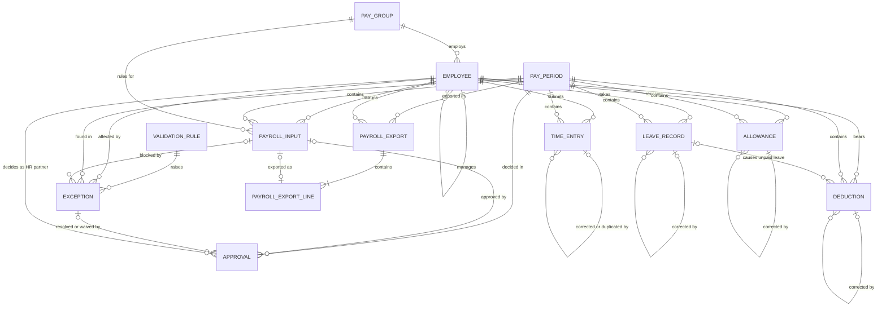

# Entity Relationship Diagram

## Relationships and cardinality

| Parent | Child | Cardinality | Optional? | Foreign key |
|---|---|---|---|---|
| PayGroup | Employee | 1:N | no, every employee has a group | Employee.pay_group_id |
| Employee | Employee (manager) | 1:N | yes, top-level managers have none | Employee.manager_id |
| Employee | TimeEntry | 1:N | yes, only hourly staff have entries | TimeEntry.employee_id |
| Employee | LeaveRecord | 1:N | yes, only salaried staff have leave | LeaveRecord.employee_id |
| Employee | Allowance | 1:N | yes | Allowance.employee_id |
| Employee | Deduction | 1:N | yes | Deduction.employee_id |
| Employee | PayrollInput | 1:N | no, one per period | PayrollInput.employee_id |
| PayPeriod | TimeEntry, LeaveRecord, Allowance, Deduction, PayrollInput | 1:N | no | each table's pay_period_id |
| PayGroup | PayrollInput | 1:N | no | PayrollInput.pay_group_id |
| TimeEntry, LeaveRecord, Allowance, Deduction | itself (correction) | 1:0..N | yes, only corrections and duplicates | related_*_id |
| LeaveRecord | Deduction | 1:0..1 normally (1:N only in the double-deduction anomaly) | yes | Deduction.leave_id |
| ValidationRule | Exception | 1:N | no | Exception.rule_id |
| Employee, PayPeriod | Exception | 1:N | no | Exception.employee_id, pay_period_id |
| PayrollInput | Exception | 1:N | yes | Exception.payroll_input_id |
| PayPeriod | Approval | 1:N | no | Approval.pay_period_id |
| PayrollInput | Approval | 1:N | yes, only payroll_input_approved | Approval.payroll_input_id |
| Exception | Approval | 1:N | yes, only resolve and waive | Approval.exception_id |
| Employee (HR partner) | Approval, PayrollExport | 1:N | no | Approval.decided_by, PayrollExport.exported_by |
| PayPeriod | PayrollExport | 1:N | no | PayrollExport.pay_period_id |
| PayrollExport | PayrollExportLine | 1:N | no, at least one line | PayrollExportLine.export_id |
| PayrollInput | PayrollExportLine | 1:0..1 | yes, only approved inputs export | PayrollExportLine.payroll_input_id |

Approval of source records (time, leave, allowance, deduction) is stored on those rows through approved_by, which is an additional foreign key to Employee. It is left off the diagram to keep it readable.

## Many-to-many relationships

There is no direct many-to-many. Exception is the bridge between ValidationRule and the records the rules flag, since one rule can flag many records and one record can break many rules. Exception.source_table and source_record_id point at the flagged record generically, so they have no database foreign key. validate.py checks that the referenced record exists.

## Effective dates and lifecycle states

| Entity | Effective dating | Lifecycle |
|---|---|---|
| PayGroup | effective_from | active, inactive |
| ValidationRule | effective_from (a change is a new row) | current rule is the latest per rule_code |
| PayPeriod | start_date, end_date | open -> validating -> approved -> exported |
| TimeEntry, LeaveRecord, Allowance, Deduction | work/leave dates and created_at | pending -> approved or rejected, set when the row is created |
| PayrollInput | calculated_at | calculated -> flagged -> calculated -> approved -> exported |
| Exception | detected_at | open -> resolved or waived |

## History is never overwritten

Corrections and duplicate submissions are new rows. Approval, Exception and PayrollExport rows record every status change. PayrollInput and PayPeriod show the current status only, and each of their changes has a matching Approval or PayrollExport row.

## Join validation

validate.py checks that every foreign key in the table above points to an existing parent row. It also checks these cross-table rules:
- every related_*_id points to an original row of the same employee
- a TimeEntry's work_date falls inside its pay period
- Deduction.leave_id refers to an unpaid LeaveRecord of the same employee and period
- Approval.decided_by and PayrollExport.exported_by have the hr_partner role